<a href="https://kurtgavin.vercel.app">
  <picture>
    <source media="(prefers-color-scheme: dark)" srcset="https://raw.githubusercontent.com/kurtgav/kurtgav/main/assets/card-dark.svg">
    
  </picture>
</a>

<samp>
  <a href="https://kurtgavin.vercel.app">portfolio</a> ·
  <a href="https://thirdcodesolutions.com">third&nbsp;code</a> ·
  <a href="https://www.linkedin.com/in/kurtgavin/">linkedin</a> ·
  <a href="https://x.com/strangeyunabiii">x</a>
</samp>

 

### <samp>selected work</samp>

<table>
  <tr>
    <td width="50%" valign="top">
      <a href="https://deal-pilot-web.vercel.app"><b>DealPilot AI</b></a> 
      Real-time voice AI sales engineer. Joins live B2B discovery calls, qualifies prospects, hands off CRM-ready notes. 
      <samp>voice ai · typescript · <a href="https://github.com/kurtgav/deal-pilot">source</a></samp>
    </td>
    <td width="50%" valign="top">
      <a href="https://helix-eight-silk.vercel.app"><b>Helix</b></a> 
      AI operating layer for healthcare ops. Eligibility checks, pre-authorizations and denial catching for PhilHealth and PH HMOs. 
      <samp>healthcare ai · typescript · <a href="https://github.com/kurtgav/Helix">source</a></samp>
    </td>
  </tr>
  <tr>
    <td width="50%" valign="top">
      <a href="https://simula-iota.vercel.app"><b>SIMULA</b></a> 
      Decision rehearsal, with receipts. Pressure-test campaign messages before fieldwork in a traceable workspace. 
      <samp>simulation · typescript</samp>
    </td>
    <td width="50%" valign="top">
      <a href="https://garage-desk-tau.vercel.app"><b>Garage Desk</b></a> 
      Job cards, quotes and customer approvals for independent garages. Every status change on one timeline. 
      <samp>smb saas · typescript · <a href="https://github.com/kurtgav/garage-desk">source</a></samp>
    </td>
  </tr>
  <tr>
    <td width="50%" valign="top">
      <a href="https://kurtgav.github.io/takip/"><b>TAKIP</b></a> 
      Cover sensitive information in photos before you share. Runs privately, on your device. 
      <samp>privacy · javascript · <a href="https://github.com/kurtgav/takip">source</a></samp>
    </td>
    <td width="50%" valign="top">
      <a href="https://brgypulo.vercel.app"><b>Barangay Pulo</b></a> 
      Official site of Barangay Pulo, Cabuyao City. Services, announcements and local news for residents. 
      <samp>civic tech · typescript</samp>
    </td>
  </tr>
</table>

<samp>50+ live products at <a href="https://thirdcodesolutions.com">Third Code Solutions</a> →</samp>

 

<picture>
  <source media="(prefers-color-scheme: dark)" srcset="https://raw.githubusercontent.com/kurtgav/kurtgav/output/snake-dark.svg">
  
</picture>
